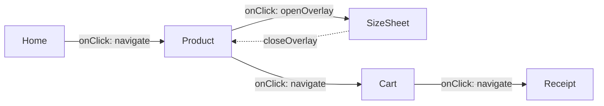

# FigCraft App — Prototype Analysis

The app has no flow analyzer: read `interactions` from the layer tree and build the graph yourself.
Load `figcraft-app:use` first.

## Skill Boundaries

- Analyze and document existing flows → this skill; it can also fix gaps (Step 6).
- Build a new flow from scratch → `figcraft-app:multi-screen-flow` + `proto.interaction.add`.
- Visual quality → `figcraft-app:design-review`.

## Workflow

### 1. Connect

`inspect_ui {}`, `doc.list`, `page.list`.

### 2. Collect

- Screens: top-level frames of the page(s) (`inspect_document {depth: 1}`, or `allPages: true`).
- Interactions: `get_node {id: screen, depth: 8}` for each screen; every layer with `interactions` is a
  hotspot. Each interaction is `{trigger {type}, actions [{type, dest?, …}], transition, duration_ms}`.
  Instances may inherit interactions from their main component: check the main (`mainComponent` id) too.
- Flows: starting points are in `proto.flow.*` (rename/remove take `start`); the first frame of each flow is
  an entry point.
- Settings: device and presenter options affect review only, not the graph.

### 3. Build the graph

Edge = (screen containing the hotspot) → (top-level frame containing `dest`), labelled
`trigger → action` (`onClick → navigate`). Overlays (`openOverlay`, `swapOverlay`) are edges of their own
kind; `back` and `closeOverlay` return to the caller; `scrollTo` stays on the screen; `openUrl` leaves the
prototype; `conditional` / `setVariable` actions: note them, follow every branch's navigation.

Compute:
- **Entry points** — flow starts, plus screens with outgoing but no incoming edges.
- **Dead ends** — incoming but no outgoing edge and no `back`.
- **Loops** — cycles; flag ones with no exit edge.
- **One-way** — A → B with no route back to A.
- **Orphans** — no edges at all.
- **Trigger stats** — counts per trigger type; screens with only `onClick`.

### 4. Present the summary

```
Flow health — 9 screens, 14 interactions, 1 flow ("Main")
Entry: Home · Dead ends: Receipt · Orphans: Settings (old) · Loops: Cart ⇄ Product (has exit)
Triggers: onClick 12, afterDelay 1, keyPress 1
```

### 5. Mermaid diagram



Dashed edges for overlays and back. Save as Markdown when the user asks.

### 6. Highlight and fix gaps (optional)

Flag: dead ends, missing back navigation, trapping loops, onClick-only screens (add `keyPress` for keyboard
users), orphans. On the user's go-ahead, wire them in one batch:

```json
{"label": "Wire flow gaps", "commands": [
  {"command": "proto.interaction.add", "params": {"id": 212, "trigger": {"type": "onClick"}, "action": {"type": "back"}}},
  {"command": "proto.interaction.add", "params": {"id": 230, "trigger": {"type": "onClick"}, "action": {"type": "navigate", "dest": 101}}},
  {"command": "proto.interaction.add", "params": {"id": 230, "trigger": {"type": "keyPress", "key": "Enter"}, "action": {"type": "navigate", "dest": 101}}}
]}
```

Then re-run Steps 2–4 to show the updated health, and offer `proto.preview {start}` (attached app) to try it.

## Commands

| Need | Command |
|---|---|
| Add / replace / remove | `proto.interaction.add {id, trigger, action}`, `proto.interaction.set {id, index, …}`, `proto.interaction.remove {id, index}`, `proto.interaction.clear {ids}` |
| Edit one action / conditional | `proto.action.add|set|remove|move`, `proto.conditional.addBlock|setCondition|removeBlock` |
| Flows | `proto.flow.add {start, name}`, `proto.flow.rename {start, name, description}`, `proto.flow.remove {start}` |
| Device | `proto.settings {device: "iPhone 16 Pro", responsive?}` |
| Play | `proto.present {start}`, `proto.preview {start}` (live pane), `proto.closePreview` |
| Check an expression | `proto.evaluate {expression: "count >= 3", id?}` |
